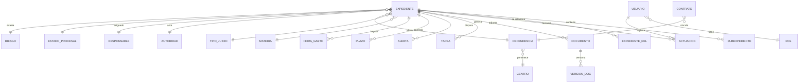
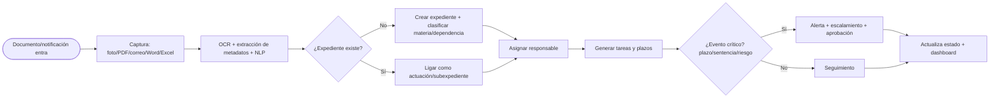

# Módulo Especializado de Gestión Integral de Expedientes — SIGEJ-UdeG
## Proyecto enterprise · Oficina de la Abogacía General · Universidad de Guadalajara
*Comparable a iManage · NetDocuments · Thomson Reuters HighQ · LemonSuite · Tirant Gestión de Despachos — especializado al sector público universitario.*

> Diseño de 🔍 **Veritas** (núcleo LEXCLAW) sobre la base real `juicios.tab` (749 expedientes consolidados). Complementa el [proyecto SIGEJ-UdeG](SIGEJ-UdeG_Proyecto.md). Artefacto vivo: `modulo_expedientes_SIGEJ.html`.

---

## 1. Arquitectura funcional
Módulo de **matter & document management** con 15 bloques (I–XV del requerimiento) sobre 4 capas:

```mermaid
flowchart TB
  subgraph UI[Presentación]
   A[Buscador + filtros]:::a---B[Ficha de expediente]:::a---C[Dashboard del módulo]:::a---D[Add-in Outlook/Teams]:::a
  end
  subgraph SVC[Servicios]
   E[Expedientes/Subexpedientes]:::b---F[Captura+OCR+NLP]:::b---G[Gestión documental/versionado]:::b
   H[Workflows/Alertas]:::b---I[Plazos/Agenda]:::b---J[Tareas/Horas]:::b---K[Reportes/BI]:::b
  end
  subgraph INT[Integraciones]
   L[(SharePoint/M365)]---M[(Outlook/Teams)]---N[(Power Automate)]---O[(Power BI)]---P[(Azure AI/OCR)]
  end
  subgraph DAT[Datos]
   Q[(OLTP)]---R[(Repositorio documental)]---S[(Índice semántico/vector)]
  end
  UI-->SVC-->DAT
  SVC<-->INT
  classDef a fill:#0a4d8c,color:#fff;classDef b fill:#1aa39a,color:#fff;
```

## 2. Arquitectura de datos
- **OLTP transaccional** (PostgreSQL/SQL Server): expediente, actuación, documento, tarea, alerta, plazo, hora, contrato.
- **Repositorio documental** (SharePoint/Azure Blob) con metadatos enlazados al expediente.
- **Índice semántico** (vector store) para búsqueda por significado y clasificación NLP.
- **Capa analítica** (modelo estrella → Power BI) compartida con el CMI de SIGEJ.

## 3. Modelo Entidad-Relación



## 4. Diccionario de datos (tabla `expediente`, campos III)
| Campo | Tipo | Origen `juicios.tab` | Notas |
|---|---|---|---|
| num_expediente | varchar | col10 | clave (NN/AAAA) |
| materia | FK | col24 | Laboral/Civil/Penal (refinable) |
| tipo_juicio | FK | col8 | Ordinario, Amparo… |
| dependencia | FK | col17/col4 | unidad UdeG |
| centro | FK | derivado | CU Temático/Regional/SEMS/Admin |
| actor / demandado | varchar | col3/col4 | |
| autoridad | FK | col1 | Junta/Juzgado/TCC/Sala |
| responsable | FK | col9 | abogado |
| estado_procesal | FK | col0 | |
| nivel_riesgo / score | enum/int | derivado (proxy) | semáforo |
| probabilidad_exito | varchar | proxy/ML | **a capturar/ML** |
| monto_reclamado / pasivo | decimal | parseo texto | piso parcial |
| fecha_inicio / cierre / ult_mov | date | col11/derivado | cierre **a capturar** |
| prioridad / observaciones | enum/text | derivado/col2 | |
| *campos personalizados* | json | — | **extensible** |

## 5. Casos de uso
CU-01 Crear/reabrir expediente y subexpedientes · CU-02 Relacionar expedientes · CU-03 Capturar documento (foto/PDF/correo) con OCR+NLP · CU-04 Clasificar documento automáticamente · CU-05 Consultar por cualquier dimensión (materia/dependencia/abogado/estado/año/autoridad/riesgo) · CU-06 Disparar workflow por cambio de estado/plazo · CU-07 Gestionar alertas y plazos · CU-08 Registrar horas/gastos · CU-09 Administrar contratos/licencias · CU-10 Generar reportes y exportar.

## 6. Historias de usuario
- *Como Oficialía de Partes, capturo un acuerdo escaneado y el sistema lo clasifica y lo liga al expediente por OCR.*
- *Como Abogado, filtro mis expedientes de alto riesgo y abro la ficha con un clic.*
- *Como Coordinador Jurídico, reasigno carga viendo responsables y niveles de riesgo.*
- *Como Jefa de Unidad, recibo alerta de plazo fatal en Teams 5 días antes.*
- *Como Abogado General, consulto el dashboard del módulo en tiempo real.*

## 7. BPMN — alta y ciclo del expediente


## 8. Mockups de pantallas
1. **Bandeja de expedientes** (implementada en el HTML): buscador + 7 filtros + tabla con semáforo y prioridad.
2. **Ficha de expediente** (modal): encabezado de 18 campos + categorías documentales + historial de actuaciones + paneles "a capturar".
3. **Dashboard del módulo**: KPI strip (activos, concluidos, con sentencia, alto riesgo, urgentes, pasivo).
4. **Agenda/Calendario maestro** (diseño): plazos, audiencias, semáforos de cumplimiento.

## 9. Dashboards operativos (sección XV — implementado)
Activos · concluidos · por materia/dependencia/responsable · con sentencia · con suspensión · alto riesgo · próximos vencimientos · carga de trabajo · tareas pendientes · contratos por vencer. *(Los que requieren dato no disponible se marcan "a capturar".)*

## 10. Flujos automatizados (Power Automate)
- Correo de notificación → alta/actualización de expediente.
- Cambio de estado a "Laudo/Sentencia" → tarea + alerta al responsable.
- Plazo T-5/T-1/T-0 → recordatorio Outlook/Teams.
- Riesgo crítico → escalamiento a Coordinador y provisión contable.
- Documento nuevo → OCR + clasificación + indexación semántica.

## 11. Reglas de negocio
- RB-01 Todo expediente requiere num, materia, dependencia, responsable y estado.
- RB-02 La clave de expediente es única; duplicados se fusionan.
- RB-03 Expediente "activo" = estado ≠ CONCLUIDO.
- RB-04 Prioridad "Urgente" = activo y (etapa Laudo/Sentencia o suspensión concedida o riesgo Crítico).
- RB-05 Semáforo de riesgo por score: Crítico>75, Alto≥55, Medio≥30, Bajo<30.
- RB-06 Inactividad ≥45 días naturales (art. 772 LFT) → alerta de riesgo de caducidad.
- RB-07 Documento sensible → acceso restringido por rol y dependencia.

## 12. Seguridad y gobierno de datos
- **Roles (XIV):** Abogado General · Coordinador Jurídico · Jefa de Unidad · Abogado · Auxiliar jurídico · Oficialía de Partes · Consulta.
- **Accesos:** por expediente, materia, dependencia y nivel jerárquico; restricción de documentos sensibles.
- **Seguridad (XIII):** TLS/SSL, cifrado de documentos (AES-256), MFA, bitácora de auditoría inmutable, historial de accesos, respaldo automático y DRP.
- **Gobierno:** catálogos maestros con *data stewards*, reglas de calidad, linaje, clasificación de confidencialidad (público/reservado/confidencial) alineada a transparencia y LGPDPPSO.

## 13. Integraciones
| Plataforma | Uso |
|---|---|
| **SharePoint / M365** | Repositorio documental, versionado, metadatos |
| **Outlook** | Captura de correos como actuaciones; alertas |
| **Teams** | Notificaciones y colaboración |
| **Power Automate** | Workflows y automatizaciones |
| **Power BI** | Modelo semántico y dashboards |
| **Azure (AI/Document Intelligence)** | OCR, NLP, clasificación, búsqueda semántica |

---

### Catálogo de dependencias/clientes (XI)
Construido desde el dato real (193 dependencias) y la Red Universitaria UdeG: **Rectoría General**, **Centros Universitarios Temáticos** (CUCEA, CUCS, CUCSH, CUCEI, CUCBA, CUAAD), **Centros Universitarios Regionales** (CUCOSTA, CUCIÉNEGA, CUSUR, CULAGOS, CUTONALÁ, CUVALLES, CUCSUR…), **SEMS** (preparatorias, Escuela Politécnica, Vocacional) y **dependencias administrativas/operadoras**. Perfil del cliente interno: dependencia · representante legal · expedientes vinculados · pasivo · litigiosidad.

### Anexos vivos
`modulo_expedientes_SIGEJ.html` (módulo funcional) · `expedientes_data.json` (capa de datos, 749 registros) · suite SIGEJ (`dashboard_SIGEJ.html`, `alta_direccion_SIGEJ.html`).
