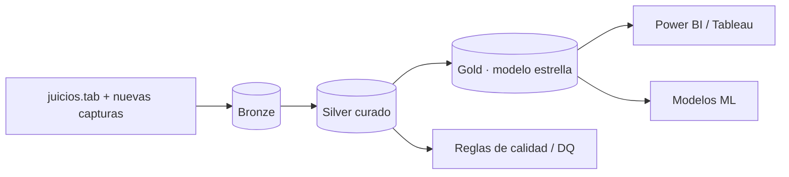
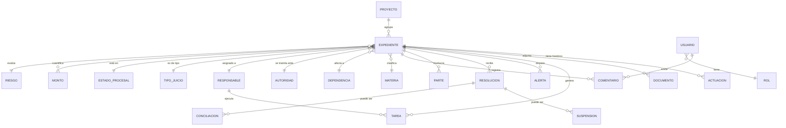
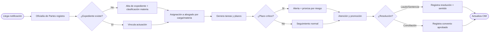

# SIGEJ-UdeG — Sistema Integral de Gestión Jurídica y Business Intelligence
## Oficina de la Abogacía General · Universidad de Guadalajara
**Proyecto de Transformación Digital de nivel empresarial**
*Comparable a LemonSuite · Tirant Gestión de Despachos · Clio · Legal Tracker · Thomson Reuters HighQ — especializado al sector público universitario.*

> Diseño elaborado por 🔍 **Veritas** (núcleo LEXCLAW) sobre la base real `juicios.tab` (821 expedientes consolidados, corte 2026-06-18). Distingue **dato documentado** de **campo a capturar**.

---

## 0. Resumen ejecutivo y diagnóstico de línea base
La Abogacía General opera hoy sobre una **hoja tabular única** con graves problemas de calidad (sin encabezados, codificación heredada, 8.8% de filas corruptas, duplicados, montos en texto libre, ausencia de campos de gestión como riesgo o probabilidad de éxito). SIGEJ-UdeG migra ese activo a una **plataforma de dirección jurídica basada en datos**: un repositorio normalizado, flujos de trabajo, BI ejecutivo y modelos predictivos.

**Línea base real (insumo del proyecto):** 821 expedientes únicos · 88% activos · 16 abogados (carga máx. 110 exp.) · materia dominante Laboral (615) · órgano dominante Junta Local C. y A. (338) · tasa de éxito 51.2% (favorable/[fav+desf]) · pasivo contingente piso $2.95M (solo 42 exp. con monto legible).

---

## 1. Arquitectura funcional
Plataforma modular en capas:

```mermaid
flowchart TB
  subgraph Pres[Capa de Presentación]
    P1[Portal web SPA]:::a --- P2[App móvil]:::a --- P3[Dashboards BI]:::a --- P4[Add-in Outlook/M365]:::a
  end
  subgraph App[Capa de Aplicación / Servicios]
    M1[Expedientes]:::b --- M2[Tareas y Agenda]:::b --- M3[Proyectos]:::b
    M4[Gestión Documental]:::b --- M5[Colaboración]:::b --- M6[Motor de Alertas]:::b
    M7[Servicios de IA/NLP]:::b --- M8[Motor de Reportes/BI]:::b
  end
  subgraph Int[Integraciones]
    I1[(M365/SharePoint)] --- I2[(Power Automate)] --- I3[(Firma electrónica)] --- I4[(SIIAU/RH UdeG)]
  end
  subgraph Dat[Capa de Datos]
    D1[(OLTP PostgreSQL/SQL Server)] --- D2[(Data Lake / Fabric)] --- D3[(Modelo semántico Power BI)]
  end
  Pres-->App-->Dat
  App<-->Int
  classDef a fill:#0a4d8c,color:#fff; classDef b fill:#1aa39a,color:#fff;
```

**Módulos (mapa a los apartados I–IX del requerimiento):** Expedientes (I) · Tareas/Kanban/Gantt (II) · Proyectos (III) · Documental+OCR+búsqueda semántica (IV) · Colaboración (V) · BI/CMI (VI, VIII) · ML (VII) · Tablero Alta Dirección (IX).

---

## 2. Arquitectura de datos
Patrón **medallón** sobre Microsoft Fabric/Azure (o equivalente PostgreSQL + dbt + Power BI):

- **Bronze (raw):** ingesta tal cual (incluido el histórico `juicios.tab`) con linaje.
- **Silver (curado):** normalización, deduplicación por expediente, catálogos controlados, corrección de codificación, separación de eventos procesales.
- **Gold (semántico):** tablas de hechos y dimensiones (modelo estrella) que alimentan el CMI y los modelos ML.



**Modelo estrella (Gold):** `FACT_EXPEDIENTE`, `FACT_ACTUACION`, `FACT_TAREA`, `FACT_RESOLUCION` rodeadas por dimensiones `DIM_MATERIA`, `DIM_DEPENDENCIA`, `DIM_AUTORIDAD`, `DIM_RESPONSABLE`, `DIM_TIEMPO`, `DIM_ESTADO_PROCESAL`, `DIM_TIPO_JUICIO`, `DIM_RIESGO`.

---

## 3. Modelo Entidad-Relación (OLTP)



---

## 4. Catálogo de tablas

| Tabla | Tipo | Descripción | Reg. estimados (línea base) |
|---|---|---|---|
| `expediente` | Maestra | Núcleo del asunto jurídico | 821 |
| `actuacion` | Transaccional | Eventos del histórico procesal | ~15,000 (texto a parsear) |
| `resolucion` | Transaccional | Laudos/sentencias/interlocutorias | 252 con resolución |
| `suspension` | Transaccional | Provisional/definitiva/otras medidas | 48 candidatas |
| `conciliacion` | Transaccional | Convenios y acuerdos aprobados | 13 |
| `tarea` | Transaccional | Pendientes, vencimientos, plazos | nuevo |
| `documento` | Documental | Archivos + metadatos + versión | nuevo (vía SharePoint) |
| `monto` | Transaccional | Reclamado/contingente/recuperado | 42 con monto legible |
| `parte` | Catálogo-rel | Actores y demandados | ~960 |
| `materia` | Dimensión | Laboral, Civil, Administrativa… | 8 |
| `dependencia` | Dimensión | Centros/preparatorias/coordinaciones UdeG | 193 |
| `autoridad` | Dimensión | Juntas, juzgados, tribunales, salas | 187 normalizables |
| `responsable` | Dimensión | Abogados de la Abogacía General | 16 |
| `tipo_juicio` | Dimensión | Ordinario, amparo, especial… | 12 |
| `estado_procesal` | Dimensión | Trámite, pruebas, laudo, concluido… | 12 |
| `riesgo` | Dimensión | Bajo/Medio/Alto/Crítico (a capturar) | nuevo |
| `proyecto` | Maestra | Litigios estratégicos, normativos | nuevo |
| `usuario` / `rol` | Seguridad | Identidades y perfiles | nuevo |
| `alerta` | Transaccional | Vencimientos y reglas | nuevo |
| `comentario` / `minuta` | Colaboración | Notas y minutas | nuevo |

---

## 5. Diccionario de datos (tabla `expediente`) — con trazabilidad a la fuente

| Campo | Tipo | Origen en `juicios.tab` | Obligatorio | Notas |
|---|---|---|---|---|
| `id_expediente` | PK uuid | (generado) | Sí | |
| `num_expediente` | varchar | col 10 | Sí | formato `NN/AAAA(-S/A)`; clave de dedup |
| `anio` | int | derivado de col 10 | Sí | radicación; **no** usar col 11 (movimientos) |
| `id_materia` | FK | col 24 | Sí | grueso; refinar con col 8+autoridad |
| `id_tipo_juicio` | FK | col 8 | Sí | |
| `id_dependencia` | FK | col 17 / col 4 | Sí | |
| `id_autoridad` | FK | col 1 | Sí | normalizar typos ("Concilición") |
| `id_responsable` | FK | col 9 | Sí | abogado interno |
| `actor` | varchar | col 3 | Sí | |
| `demandado` | varchar | col 4 | Sí | usualmente UdeG/dependencia |
| `prestaciones` | text | col 2 | No | |
| `id_estado_procesal` | FK | col 0 | Sí | |
| `sentido_resolucion` | varchar | col 12 | No | solo si hay resolución |
| `sistema_regimen` | varchar | col 23 | No | "Sistema Anterior/Actual" (pensiones) |
| `riesgo_juridico` | enum | **— a capturar —** | No | Bajo/Medio/Alto/Crítico |
| `probabilidad_exito` | decimal | **— a capturar / ML —** | No | 0–100% |
| `monto_reclamado` | decimal | parseo de cols 2,5,15,22 | No | hoy en texto libre |
| `monto_contingente` | decimal | **— a capturar —** | No | provisión institucional |
| `fecha_inicio` | date | col 11 / derivado | No | |
| `fecha_cierre` | date | **— a capturar —** | No | |
| `etiquetas` | array | **— a capturar —** | No | |

---

## 6. KPIs (definición operacional)

| KPI | Fórmula | Valor línea base |
|---|---|---|
| Índice de litigiosidad | nuevos por año / dependencia | 2025: 146 |
| % expedientes activos | activos / total | 88.0% |
| Tasa de éxito procesal | favorables / (fav+desf) | 51.2% |
| Tiempo promedio de resolución | Σ(fecha_res − fecha_inicio)/n | *a calcular tras parseo* |
| Carga por abogado | exp. asignados / abogado | máx 110 · prom 47 |
| Índice de rezago | activos sin actuación > N días / activos | *requiere fechas* |
| Pasivo contingente | Σ monto_contingente | piso $2.95M |
| Eficiencia procesal | concluidos / (concluidos+activos) | 12.0% |
| % cumplimiento de plazos | tareas a tiempo / tareas | nuevo |

---

## 7–9. Dashboards (entregados como artefacto vivo)

- **Ejecutivo** (`dashboard_SIGEJ.html` → pestaña *Ejecutivo*): KPI cards, materia, año, estado, tipo de juicio, órgano.
- **Operativo** (*Litigios* + *Productividad*): sentido de resolución, suspensiones, embudo de conclusión, carga por abogado.
- **Estratégico** (*Riesgos*): mapa de calor dependencia×materia, Pareto de litigiosidad; en producción se suma tendencia histórica y pasivo contingente por unidad.

Visualizaciones (apartado VIII): tarjetas KPI ✓, barras ✓, líneas de tiempo ✓, mapa de calor ✓, embudo ✓, Pareto ✓; en BI productivo se añaden Treemap, Sankey (flujo materia→órgano→resolución), Gantt y Radar.

---

## 10. Mockups de pantallas (wireframe textual)

```
┌── SIGEJ-UdeG ───────────────────────────────[buscar 🔍][🔔3][Edith ▾]┐
│ ☰ │ Expedientes · Tareas · Proyectos · Documentos · BI · Admin       │
├───┼────────────────────────────────────────────────────────────────┤
│   │  [Activos 659][Riesgo crítico 7][Vencen hoy 4][Pasivo $—]        │
│   │  ┌ Bandeja de pendientes ─────────┐ ┌ Calendario jurídico ─────┐ │
│   │  │ ▣ 514/2025  Laudo  ven. 20/06  │ │  L  M  M  J  V            │ │
│   │  │ ▣ 101/2025  Amparo ven. 21/06  │ │       ●        ●●         │ │
│   │  └────────────────────────────────┘ └──────────────────────────┘ │
│   │  ┌ Kanban ── Trámite | Pruebas | Laudo | Amparo | Concluido ───┐ │
│   │  │  [tarj][tarj]  [tarj]   [tarj]   [tarj]    [tarj]           │ │
│   │  └────────────────────────────────────────────────────────────┘ │
└───┴────────────────────────────────────────────────────────────────┘
```
Pantallas núcleo: (1) Detalle de expediente con pestañas *Datos/Actuaciones/Documentos/Tareas/Riesgo*; (2) Tablero Kanban; (3) Gantt de proyecto; (4) Dashboard Alta Dirección; (5) Repositorio documental con OCR.

---

## 11. Flujos BPMN



---

## 12. Casos de uso (selección)
- **CU-01 Registrar expediente** (Actor: Oficialía de Partes).
- **CU-02 Asignar responsable por carga/materia** (Coordinador).
- **CU-03 Controlar vencimientos y alertas** (Abogado/Sistema).
- **CU-04 Capturar riesgo y probabilidad de éxito** (Abogado).
- **CU-05 Registrar resolución/suspensión/conciliación** (Abogado).
- **CU-06 Consultar CMI de Alta Dirección** (Abogacía General).
- **CU-07 Predecir duración/sentido** (Sistema ML).
- **CU-08 Gestionar proyecto normativo** (Líder de proyecto).

---

## 13. Historias de usuario (muestra)
- *Como Abogado General, quiero ver en tiempo real el pasivo contingente por dependencia para priorizar provisiones.*
- *Como abogado litigante, quiero alertas automáticas 5 días antes de cada vencimiento para no perder términos.*
- *Como coordinador, quiero balancear la carga (hoy 110 vs 33 exp.) para repartir equitativamente.*
- *Como responsable de transparencia, quiero clasificar y resguardar documentos con control de versiones.*
- *Como dirección, quiero un mapa de calor de litigiosidad por centro universitario para focalizar prevención.*

---

## 14. Requerimientos funcionales (extracto)
RF-01 Alta/baja/edición de expedientes con catálogos controlados · RF-02 Histórico de actuaciones con fecha y tipo · RF-03 Gestión de tareas (Kanban+Gantt) · RF-04 Motor de alertas por plazos y riesgo · RF-05 Repositorio documental con versionado, OCR y búsqueda semántica · RF-06 Integración M365/SharePoint/Outlook · RF-07 Firma electrónica · RF-08 Flujo de autorizaciones · RF-09 CMI con drill-down · RF-10 Módulos ML (predicción y clasificación) · RF-11 Bitácora de auditoría · RF-12 Exportación a Power BI/Excel.

## 15. Requerimientos no funcionales
RNF-01 Disponibilidad 99.5% · RNF-02 Cifrado en reposo y tránsito (TLS1.3/AES-256) · RNF-03 RBAC y MFA · RNF-04 Trazabilidad/auditoría inmutable · RNF-05 Cumplimiento LGPDPPSO y normativa universitaria · RNF-06 Tiempo de respuesta <2s en consultas BI · RNF-07 Escalabilidad a 50k expedientes · RNF-08 Respaldo diario y DRP · RNF-09 Accesibilidad WCAG 2.1 AA · RNF-10 Bilingüe de catálogos.

---

## 16. Roadmap de implementación

| Fase | Meses | Entregable |
|---|---|---|
| 0 · Discovery + Calidad de datos | 1–2 | Saneamiento de `juicios.tab`, catálogos, MER validado |
| 1 · MVP Expedientes + Tareas | 3–5 | Alta, histórico, Kanban, alertas |
| 2 · Documental + M365 | 6–8 | SharePoint, OCR, firma, búsqueda semántica |
| 3 · BI / CMI | 9–10 | Dashboards ejecutivo/operativo/estratégico |
| 4 · IA / ML | 11–14 | Clasificación automática, predicción duración/sentido |
| 5 · Alta Dirección + Gobierno | 15–16 | Tablero directivo, data governance, auditoría |

---

## 17. Gobierno de datos
- **Catálogos maestros** (materia, autoridad, dependencia) con *data stewards* designados.
- **Reglas de calidad** automatizadas (unicidad de expediente, formatos de fecha, montos numéricos, no-nulos críticos).
- **Linaje** Bronze→Gold y **glosario** institucional.
- **Política de retención** y clasificación de confidencialidad (público/reservado/confidencial) alineada a transparencia y protección de datos.

## 18. Seguridad y perfiles de usuario
| Rol | Permisos |
|---|---|
| Abogacía General (Dirección) | Lectura total + CMI directivo |
| Coordinador de área | Gestión de su cartera + asignación |
| Abogado litigante | CRUD de sus expedientes/tareas |
| Oficialía de Partes | Alta y registro de actuaciones |
| Transparencia/Datos | Gestión documental y clasificación |
| Auditoría | Solo lectura + bitácora |
| Administrador | Configuración y catálogos |

Controles: RBAC + MFA + cifrado + bitácora inmutable + segregación por dependencia.

## 19. Automatizaciones (Power Automate / flujos)
- Alta automática de expediente desde correo de notificación (Outlook → SIGEJ).
- Recordatorios de vencimiento (T-5, T-1, T-0) por correo/Teams.
- Generación de minutas y acuses; rutas de firma electrónica.
- Reclasificación automática (NLP) de materia y riesgo al ingresar.
- Actualización nocturna del modelo semántico del CMI.

## 20. Modelos predictivos y analítica avanzada (apartado VII)
| Modelo | Tipo | Variables (de la base) | Salida |
|---|---|---|---|
| Predicción de sentido | Clasificación (XGBoost/LogReg) | materia, tipo juicio, autoridad, dependencia, prestaciones (NLP) | Favorable/Desfavorable + prob. |
| Duración del juicio | Regresión/Survival | año, materia, órgano, nº actuaciones | meses estimados |
| Clasificación automática de expedientes | NLP (embeddings) | texto de prestaciones/actuaciones | materia fina + etiquetas |
| Detección de cuellos de botella | Process mining | secuencia de estados/fechas | etapas con mayor demora |
| Detección de riesgo/prioridad | Scoring | monto, materia, etapa, antigüedad | Riesgo Bajo→Crítico |
| Predicción de carga de trabajo | Series de tiempo | ingresos por mes/dependencia | demanda proyectada |

**Principios de IA responsable:** modelos **explicables** (SHAP), validación con métricas (AUC, MAE), monitoreo de *drift*, y **supervisión humana**: el modelo sugiere, el abogado decide. Cero decisión automatizada sobre derechos.

---

### Anexos (artefactos reales entregados)
- `dashboard_SIGEJ.html` — CMI interactivo sobre datos reales.
- `BASE_UNICA_consolidada.csv` — base Silver inicial (749).
- `RECUPERADAS_74.csv`, `SUSPENSION_clasificada.csv`, `SENTENCIAS_tipo_fecha.csv`, `MATERIA_POR_ANIO.csv`.
- `dashboard_data.json` — capa Gold (agregados del CMI).
